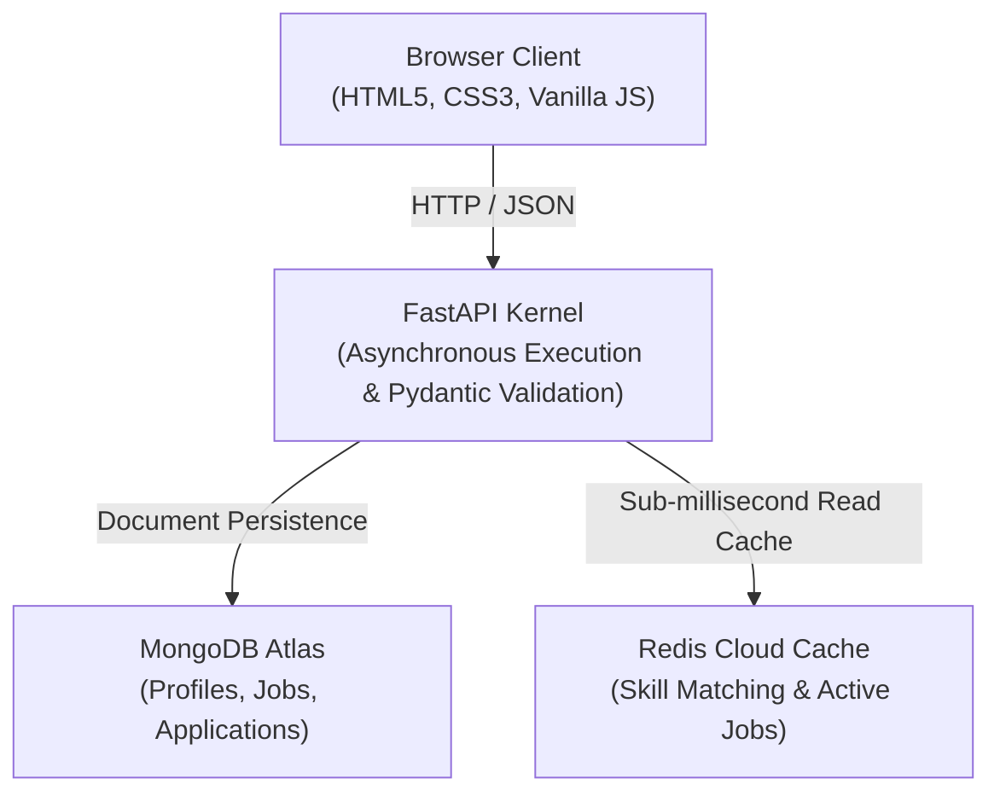

# 🌟 NexusTalent — High-Performance Talent Marketplace & Matching Engine

[](https://fastapi.tiangolo.com)
[](https://www.python.org/)
[](https://www.mongodb.com/atlas)
[](https://redis.io/)
[](LICENSE)

**NexusTalent** is a production-ready, full-stack talent marketplace and profile-matching ecosystem designed as a low-latency, specialized alternative to enterprise platforms. Built on an asynchronous **FastAPI** backend, **MongoDB Atlas** for document persistence, and **Redis Cloud** for sub-millisecond caching of skill-matching queries, NexusTalent delivers a smooth, lightning-fast experience for both job seekers and recruiters.

---

## 📸 Key Features at a Glance

### 👤 Candidate & Talent Portal (`/`)
- **Authentication & Sessions**: Secure sign up and login with SHA-256 hashed passwords and token-based session verification.
- **Dynamic Profile Management**: Manage bio, experience, contact details, and an interactive skill tag inventory.
- **Skill-Based Matching Engine**: Live job matching based on candidate skill arrays, powered by Redis-cached set intersections for near-zero query overhead.
- **One-Click Applications**: Seamless application workflow preventing duplicate submissions.
- **Application Tracking**: Real-time status tracker (⏳ Pending, 🔍 Reviewing, ✅ Accepted, ❌ Rejected, 🎉 Hired).

### 🛡️ Recruiter & Admin Dashboard (`/admin`)
- **Secure Access**: HTTP Basic Authentication protecting all management endpoints.
- **Real-Time Analytics**: Dashboard statistics displaying active jobs, total candidates, applications received, and hired metrics.
- **Job Lifecycle Management (CRUD)**: Create, edit, inspect, and delete job postings with automatic Redis cache invalidation.
- **Candidate Pipeline Management**: Inspect candidate details, resumes, applied positions, and update application statuses directly from the dashboard.

---

## 🏗️ Architecture & Tech Stack



| Layer | Technology | Description |
| :--- | :--- | :--- |
| **Backend** | [FastAPI](https://fastapi.tiangolo.com/) | Asynchronous Python REST framework with automatic OpenAPI docs |
| **Data Validation** | [Pydantic v2](https://docs.pydantic.dev/) | Strict schema validation and type safety |
| **Primary Database**| [MongoDB Atlas](https://www.mongodb.com/atlas) | Cloud NoSQL database storing users, jobs, and applications |
| **Cache Layer** | [Redis Cloud](https://redis.io/) | In-memory key-value store caching matching jobs and sessions |
| **Frontend** | Vanilla JS & Semantic CSS3 | Zero-dependency, lightweight, reactive UI with glassmorphism |
| **Templating** | [Jinja2](https://palletsprojects.com/p/jinja/) | Server-side template rendering for portal entrypoints |

---

## 📁 Repository Structure

```text
NexusTalent/
├── config/
│   ├── __init__.py
│   └── database.py          # PyMongo client & Redis connection initializers
├── models/
│   ├── __init__.py
│   └── schemas.py           # Pydantic schemas (User, Profile, Job, Application)
├── routes/
│   ├── __init__.py
│   ├── admin.py             # Recruiter portal API & HTTP Basic Auth handlers
│   └── talent.py            # Candidate auth, profiles, applications & matching API
├── static/
│   ├── css/
│   │   └── style.css        # Responsive design system & micro-animations
│   └── js/
│       ├── admin.js         # Recruiter admin dashboard controller
│       └── app.js           # Candidate marketplace client-side logic
├── templates/
│   ├── admin.html           # Recruiter dashboard Jinja2 template
│   └── index.html           # Candidate marketplace Jinja2 template
├── .gitignore
├── main.py                  # Application entry point & router mounting
├── README.md                # Project documentation
└── requirements.txt         # Pinned Python package dependencies
```

---

## 🚀 Getting Started

### Prerequisites

- **Python 3.10+** installed
- A **MongoDB Atlas** cluster URI (or local MongoDB)
- A **Redis Cloud** instance URI (or local Redis instance)

### 1. Clone the Repository

```bash
git clone https://github.com/ashishmg11435-web/NexusTalent.git
cd NexusTalent
```

### 2. Set Up Virtual Environment

```bash
# Windows
python -m venv .myenv
.myenv\Scripts\activate

# macOS / Linux
python3 -m venv .myenv
source .myenv/bin/activate
```

### 3. Install Dependencies

```bash
pip install -r requirements.txt
```

### 4. Configure Environment Variables

Create a `.env` file in the project root directory:

```env
# MongoDB Atlas Configuration
MONGODB_URL=mongodb+srv://<username>:<password>@<cluster>.mongodb.net/?retryWrites=true&w=majority
MONGODB_DB_NAME=nexustalent

# Redis Cloud Configuration
REDIS_URL=redis://:<password>@<host>:<port>

# Admin / Recruiter Credentials
ADMIN_USERNAME=admin
ADMIN_PASSWORD=admin123
```

> **Security Tip**: Never commit your `.env` file to version control. It is already added to `.gitignore`.

### 5. Run the Application

```bash
uvicorn main:app --reload --port 8000
```

Once running, access the portals at:
- **Candidate Portal:** [http://127.0.0.1:8000/](http://127.0.0.1:8000/)
- **Recruiter Dashboard:** [http://127.0.0.1:8000/admin](http://127.0.0.1:8000/admin)
- **Interactive API Docs (Swagger):** [http://127.0.0.1:8000/docs](http://127.0.0.1:8000/docs)
- **Alternative API Docs (ReDoc):** [http://127.0.0.1:8000/redoc](http://127.0.0.1:8000/redoc)

---

## 📡 API Reference Overview

### Candidate / Talent Endpoints (`/api/talent`)

| Method | Endpoint | Description | Auth Required |
| :--- | :--- | :--- | :---: |
| `POST` | `/api/talent/auth/signup` | Register a new candidate account | No |
| `POST` | `/api/talent/auth/login` | Log in and receive a session token | No |
| `GET` | `/api/talent/auth/me` | Fetch active user session | Token |
| `POST` | `/api/talent/auth/logout` | Revoke user session | Token |
| `GET` | `/api/talent/jobs` | Retrieve all active job listings | No |
| `GET` | `/api/talent/jobs/match` | Query skill-matched jobs (Redis-cached) | Optional |
| `POST` | `/api/talent/jobs/{job_id}/apply`| Apply to a job posting | Token |
| `GET` | `/api/talent/applications/my` | View logged-in candidate's applications | Token |
| `POST` | `/api/talent/profile` | Create/update talent profile | Token |
| `GET` | `/api/talent/profile/{email}` | Retrieve talent profile by email | Token |

### Recruiter / Admin Endpoints (`/api/admin`)

| Method | Endpoint | Description | Auth Required |
| :--- | :--- | :--- | :---: |
| `GET` | `/api/admin/verify` | Verify admin credentials | HTTP Basic |
| `GET` | `/api/admin/stats` | Aggregate dashboard statistics | HTTP Basic |
| `GET` | `/api/admin/jobs` | Retrieve all jobs for admin view | HTTP Basic |
| `POST` | `/api/admin/jobs` | Publish a new job posting | HTTP Basic |
| `PUT` | `/api/admin/jobs/{job_id}` | Edit an existing job posting | HTTP Basic |
| `DELETE` | `/api/admin/jobs/{job_id}` | Delete a job posting | HTTP Basic |
| `GET` | `/api/admin/applicants` | List all applicants with details | HTTP Basic |
| `PUT` | `/api/admin/applications/{app_id}/status` | Update application status | HTTP Basic |

---

## ⚡ Performance & Caching Strategy

1. **Redis Skill Matching Cache**:
   Candidate skill queries are hashed and cached with a 5-minute TTL (`JOBS_CACHE_TTL = 300`). Identical search filters or skill arrays resolve in < 2ms from memory rather than executing full database table scans.

2. **Cache Invalidation on Mutation**:
   Whenever a recruiter creates, edits, or deletes a job posting in `/api/admin/jobs`, the system invalidates active job caches, ensuring candidates immediately see updated postings without stale data.

3. **Graceful Database Fallbacks**:
   The application implements custom global exception handlers for MongoDB network timeouts (`ServerSelectionTimeoutError`), returning clear HTTP 503 diagnostics instead of crashing unhandled.
   
---

## 📝 License

Distributed under the MIT License. See `LICENSE` for more information.

---

## 👤 Author

**Ashish**  
GitHub: [@ashishmg11435-web](https://github.com/ashishmg11435-web)
